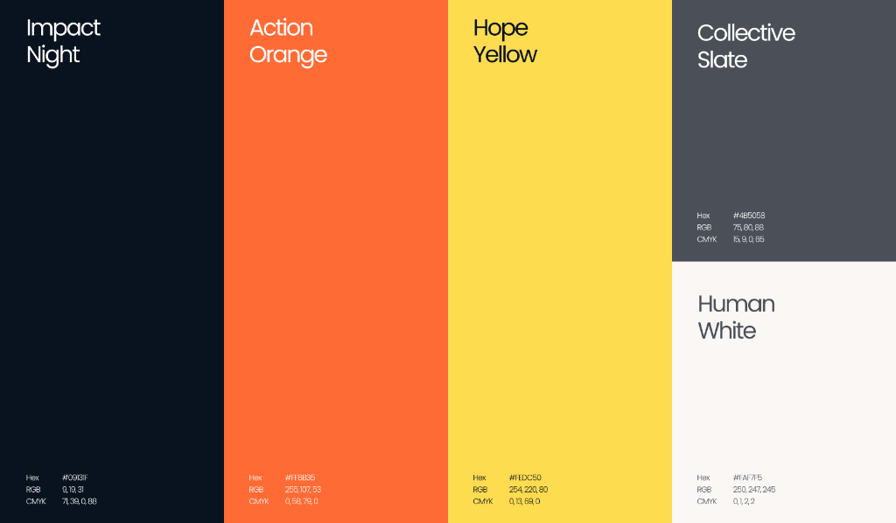

# Qrate Brand & Design Instructions

All UI, CSS, component, and graphic design updates in this repository **must** strictly follow the official Qrate brand color palette and design system defined in [AGENTS.md](../../AGENTS.md).

## Official Brand Color Palette

- **Impact Night**: `#09131F` (RGB `9, 19, 31` · CMYK `71, 39, 0, 88`) — Hero canvas (`.hero-kraft`), dark surfaces, primary text on light surfaces
- **Action Orange**: `#FF6B35` (RGB `255, 107, 53` · CMYK `0, 58, 79, 0`) — Primary brand accent, CTAs, interactive highlights
- **Hope Yellow**: `#FEDC50` (RGB `254, 220, 80` · CMYK `0, 13, 69, 0`) — Secondary warm accent, editorial highlights
- **Collective Slate**: `#4B5058` (RGB `75, 80, 88` · CMYK `15, 9, 0, 65`) — Secondary text, muted labels, structural borders
- **Human White**: `#FAF7F5` (RGB `250, 247, 245` · CMYK `0, 1, 2, 2`) — Warm light canvas, card surfaces, light text on dark backgrounds

