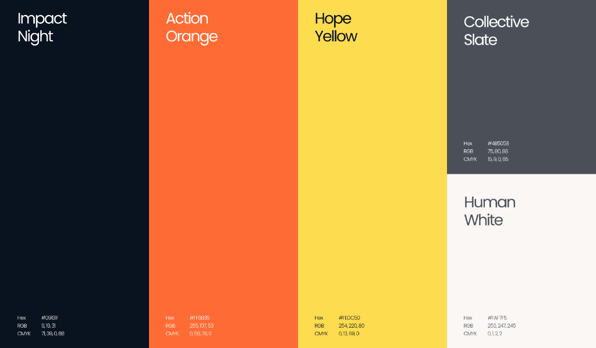

# Qrate Brand & Design Instructions

All UI, CSS, component, and graphic design updates in this repository **must** strictly follow the official Qrate brand color palette and design system defined below.

## Official Brand Color Palette

| Color Name | Hex | RGB | CMYK | Primary Usage |
| :--- | :--- | :--- | :--- | :--- |
| **Impact Night** | `#09131F` | `9, 19, 31` | `71, 39, 0, 88` | Hero backgrounds (`.hero-kraft`), primary dark surfaces, deep contrast sections, primary typography on light backgrounds |
| **Action Orange** | `#FF6B35` | `255, 107, 53` | `0, 58, 79, 0` | Primary brand accent, primary CTAs, interactive highlights, active states, focus rings |
| **Hope Yellow** | `#FEDC50` | `254, 220, 80` | `0, 13, 69, 0` | Secondary warm accent, editorial display italics/highlights on dark and light surfaces, secondary badges |
| **Collective Slate** | `#4B5058` | `75, 80, 88` | `15, 9, 0, 65` | Secondary body copy, muted labels, structural borders, subtle UI elements |
| **Human White** | `#FAF7F5` | `250, 247, 245` | `0, 1, 2, 2` | Warm light page canvas, card surfaces, primary text on Impact Night (`#09131F`) backgrounds |

## Core Design Rules

1. **Hero Canvas (`Impact Night`)**:
   - The main hero section (`.hero-kraft`) must always use solid **Impact Night** (`#09131F`) as its background color. Do not replace it with orange or light backgrounds.
2. **Color Discipline**:
   - Never introduce off-brand colors or generic Tailwind grays/blues when an official Qrate token (`#09131F`, `#FF6B35`, `#FEDC50`, `#4B5058`, `#FAF7F5`) applies.
   - Maintain high contrast and legibility across all sections (`#FAF7F5` / `#FFFFFF` text on `#09131F`, and `#09131F` / `#4B5058` text on `#FAF7F5`).
3. **Interactive & Motion Restraint**:
   - Interactive effects (such as Halo inputs, starfield backgrounds, rolling text, and liquid morphing typography) must use the Qrate palette (`#FF6B35`, `#FEDC50`, `#09131F`, `#FAF7F5`) and respect `prefers-reduced-motion`.

